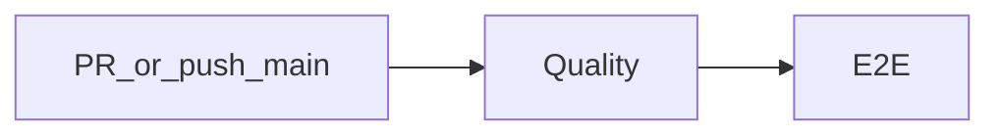

# CI and quality gates

Single GitHub Actions workflow: [`.github/workflows/ci.yml`](../../.github/workflows/ci.yml).

## Triggers

- `pull_request` targeting `main`
- `push` to `main`

Both jobs skip when the push committer name is `GitHub` (avoids bot/merge loops):

```yaml
if: github.event_name == 'pull_request' || github.event.head_commit.committer.name != 'GitHub'
```

Runtime: `ubuntu-latest`, Node **20**, `npm ci`, npm cache.

## Pipeline



### Job: Quality

Runs first. Steps in order:

1. `npm ci`
2. `npm run typecheck`
3. `npm run lint`
4. `npm run format:check`
5. `npm run test:coverage` — fails if coverage thresholds are unmet
6. `npm run build`

### Job: E2E

`needs: quality`. Steps:

1. `npm ci`
2. `npx playwright install --with-deps chromium`
3. `npm run build:e2e`
4. `npm run test:e2e` with `CI: true`
5. On failure: upload `playwright-report/` artifact (retention 7 days)

E2E foundation details: [End-to-end tests](./end-to-end-tests.md).

## Local commands

| Command                            | Purpose                                     |
| ---------------------------------- | ------------------------------------------- |
| `npm run typecheck`                | `tsc -b --pretty false`                     |
| `npm run lint`                     | `eslint .`                                  |
| `npm run format` / `format:check`  | Prettier write / check                      |
| `npm run test`                     | Vitest single run (no coverage gate)        |
| `npm run test:coverage`            | Vitest + coverage thresholds (what CI runs) |
| `npm run build`                    | Production build                            |
| `npm run build:e2e`                | Build with `.env.e2e` (mock API)            |
| `npm run test:e2e` / `test:e2e:ui` | Playwright                                  |

Engines: Node `>=20` in `package.json`.

## Coverage gate

Configured in [`vite.config.ts`](../../vite.config.ts):

| Metric     | Threshold |
| ---------- | --------- |
| lines      | 97%       |
| functions  | 97%       |
| branches   | 97%       |
| statements | 97%       |

- Provider: `v8`; reporters `text` + `html` → `coverage/`
- Include: `src/**/*.{ts,tsx}`
- `all: false` (avoids Windows drive-letter double-count quirks)
- Notable **excludes**: test files, `src/test/**`, `main.tsx`, mocks, `ui/checkbox/**`, `ui/slider/**`, `ui/index.ts`, and `src/screens/your-budget-screen/**` (covered by unit + e2e instead; see comment in config)
- Vitest excludes `e2e/**` from the unit suite

## Lint and format

[`eslint.config.js`](../../eslint.config.js):

- `@eslint/js` recommended + `typescript-eslint` recommended
- React recommended + jsx-runtime + react-hooks recommended
- `react-refresh/only-export-components` warn (`off` for e2e / playwright config)
- `eslint-config-prettier` last
- Ignores: `dist`, `coverage`, `playwright-report`, `test-results`, MSW worker

There are **no** design-token, SCSS, or `jsx-a11y` ESLint rules in-repo.

Prettier ([`.prettierrc.json`](../../.prettierrc.json)): single quotes, trailing commas, semicolons, printWidth 100, tabWidth 2, `endOfLine: lf`.

## Branch protection (human policy)

Documented in the root README (not enforced as YAML in this repo): after the workflow has run once, configure a branch ruleset on `main` that requires a pull request and the **Quality** and **E2E** status checks (0 approving reviews).

## What is not gated here

- No Codecov / coverage upload service
- No Dependabot or CODEOWNERS config in-repo
- No ESLint rules that enforce design-system class or token usage
- Local `npm run test` without coverage does not mirror CI; use `test:coverage` before opening a PR

## Related

- [End-to-end tests](./end-to-end-tests.md)
- Root [README](../../README.md) Checks section
